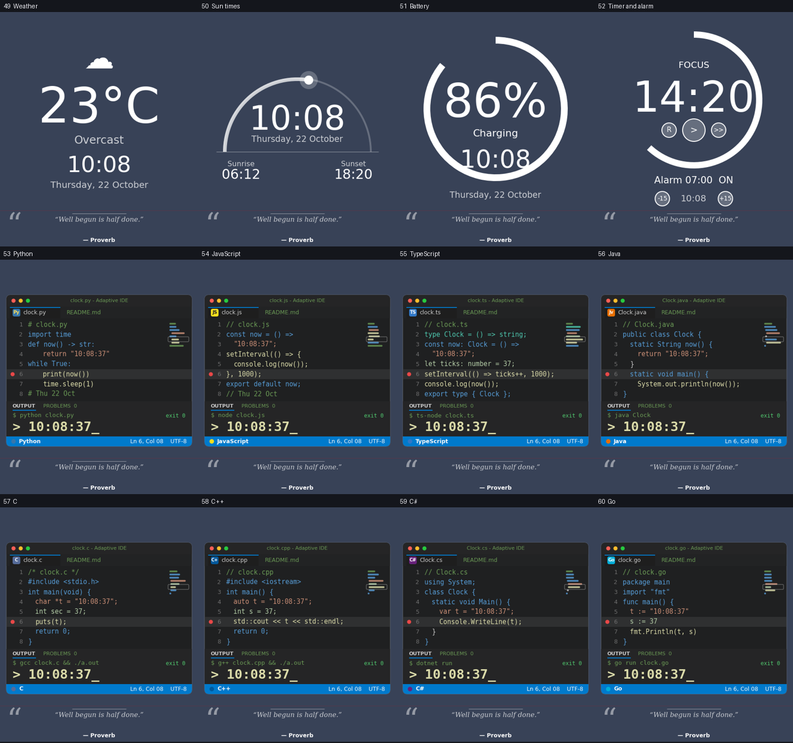

# Adaptive Clock for Rainmeter

A desktop clock with **99 styles**, built for Rainmeter on Windows. By Amika Alankara.

*(Previews are approximate renders made by `tools/preview.py`; fonts and spacing differ slightly in Rainmeter.)*

- **Coder clocks**: 19 **IDE scenes, one per programming language** (Python, JavaScript, TypeScript, Java, C, C++, C#, Go, Rust, PHP,
  Ruby, Swift, Kotlin, SQL, HTML, Bash, PowerShell, Lua, Dart). Each has editor tabs, a language badge, syntax-coloured code with
  the time written into it, a **debugger line that steps through the code every second** (breakpoint, `Ln` / `Col` in the status bar,
  minimap), and a console that "runs" the program and prints the time. Plus Terminal, Live preview, Hex clock, Binary dots,
  System monitor, Epoch and ISO, Git log, Dot matrix, **Matrix rain**, **CI pipeline** (stages pass one by one), Stack trace,
  Hexdump, Neofetch, htop and a Test runner. Four editor colour themes: Dark, Dracula, Monokai, Light.
- **Everyday clocks**: greeting, month calendar, year progress, sticky note, week strip.
- **Themes**: *Classic*, *Bloom* (pink and lilac: Blossom, Heartbeat, Flutter, Ribbon, Spectrum, Lunar Glow...) and *Volt* (electric blue and cyan: Radar Sweep, Launch, Kickoff, Neon Drive, Level Up, Grid Start, Crest...). Each has its own accent colours and clocks.
- **For everyone**: chronograph, flip clock, nixie, vinyl, compass, moon phase, skyline, aurora and many more.
- **Languages**: Windows (follows your system for dates), English, Spanish, French, German, Portuguese, Italian, Sinhala, Tamil, Hindi, Japanese.
- **Extras**: weather (optional), sunrise and sunset, battery, focus timer with alarm.
- **Adaptive colours**: black or white text chosen from the wallpaper behind the skin, or your Windows accent colour.
- **Quotes**: a friendly card, or a code-comment style for the Coder profile.
- **Settings window** (5 pages, always shows where you are) and a **style gallery** that highlights the style on screen.

## Requirements
Windows 10/11, [Rainmeter 4.x](https://www.rainmeter.net/), PowerShell (built in).

## Install
**Easiest:** download `AdaptiveClock-<version>.rmskin` from the Releases page and double-click it.

**From source:** copy the `AdaptiveClock` folder into `Documents\Rainmeter\Skins\` (keep the folder name), choose **Refresh all**
in Rainmeter, then load `AdaptiveClock\AdaptiveClock.ini`. Also available: `AdaptiveClock\Settings\Settings.ini` and
`AdaptiveClock\Gallery\Gallery.ini` (or use the last two items of the right-click menu).

Keep the `.ini`, `.lua`, `Languages.lua` and `WallpaperLuma.ps1` files together. Save `.lua` files as UTF-8.

## Mouse
Double-click for the next style. Hover to see the style name and number (and whether it is locked).

## Right-click menu
Next / random style, lock or unlock (kept after a refresh), resume shuffle and re-check wallpaper, profile, theme, language,
colour mode, next quote, show/hide quote, 12/24 h, skip this style, show all styles again, open settings, open style gallery.

## Settings window
Five pages: **Style** (profile, theme, code colours, text colour, how often the style changes), **Language** (language, 12/24 h,
week start), **Quote**, **Extras** (smooth seconds, weather, timer) and **Actions** (next / random / lock / skip, open gallery).
The top of the window shows the page you are on (`Settings > Style`) and the clock style currently on screen. On every row the
active choice is highlighted and its name is written next to the setting.

## Options (`[Variables]` in `AdaptiveClock.ini`)
| Variable | Values | Meaning |
|---|---|---|
| `Profile` | `All`, `Coder`, `Everyday` | Which styles and quotes are used |
| `Theme` | `Neutral` (Classic), `Bloom`, `Volt` | Accent palette; Bloom / Volt also add their own styles. The old values `Girl` / `Boy` still work |
| `CodeTheme` | `Dark`, `Dracula`, `Monokai`, `Light` | Colours of the editor / terminal clocks |
| `Language` | `Windows`, `English`, `Spanish`, `French`, `German`, `Portuguese`, `Italian`, `Sinhala`, `Tamil`, `Hindi`, `Japanese` | Date names, greetings and labels. The two word-clock styles need English or Windows |
| `ColorMode` | `Invert`, `Accent`, `White`, `Black` | Text colour |
| `ShuffleMinutes` | `1` to `1440` | How long each style stays |
| `SkipStyles` / `LockedStyle` | `3,7,12` / `0` or a style number | Leave styles out / keep one style |
| `HourFormat` | `%H` or `%#I` | 24 h or 12 h |
| `QuoteHidden`, `QuoteMinutes`, `QuoteStyle`, `QuoteSize` | see settings | Quote behaviour |
| `Smooth` | `0` / `1` | Smooth seconds hand (updates 10x per second, uses more CPU) |
| `Latitude`, `Longitude` | e.g. `51.5`, `-0.12` | Needed for sunrise / sunset and weather. You type them in; nothing is detected |
| `WeatherOff` | `1` / `0` | Weather is off by default (no network use). On = asks open-meteo.com every 15 min |
| `TempUnit` | `celsius`, `fahrenheit` | Weather units |
| `PomoWork`, `PomoBreak`, `TimerBeep` | minutes / minutes / `1`,`0` | Timer style |
| `AlarmTime`, `AlarmOn` | `07:00`, `0` / `1` | Alarm (use the timer style buttons) |
| `WeekStart` | `0` Sunday, `1` Monday | Calendar and week strip |
| `FontText`, `FontLight`, `FontBold`, `FontMono` | font names | Fonts for all styles |
| `Cities` | `NAME:offset:RULE\|...` | World-time cities (max 5) |

Quotes stay in English. Weather descriptions are English.

## Customise
- **Cities**: edit the `Cities=` line in `AdaptiveClock.ini`, format `NAME:offset:RULE|...` (RULE is `US`, `EU`, `AU` or `-`; max 5).
- **Quotes**: rename `quotes.example.txt` to `quotes.txt` and edit it (`text | author`, one per line). It replaces the built-in quotes for every profile.
- **Styles**: `AdaptiveClock.ini` is generated by `tools/gen_ini.py`. Edit the style functions there and re-run
  `python gen_ini.py`, or edit the `.ini` directly.
- **Style count**: if you add or remove styles, update `StyleCount` in the `.ini`.

## Developing
`AdaptiveClock.ini`, `Settings.ini` and `Gallery.ini` are generated: edit `tools/gen_ini.py` / `tools/gen_skins.py`, then run
`python gen_ini.py && python gen_skins.py && python check_ini.py` from the `tools` folder. `python preview.py` (needs matplotlib and pillow) renders every style to `docs/` and warns about text that overlaps or leaves the clock area. `python build_rmskin.py` builds
`dist/AdaptiveClock-<version>.rmskin`. To add a language, copy a block in `Languages.lua`, translate it, and add its name to
`CycleLanguage` in `AdaptiveClock.lua` and to the language list in `tools/gen_skins.py`.
GitHub Actions checks the generated files on every push and attaches the `.rmskin` to a release when you push a tag like `v4.1`.

## Author
Created by Amika Alankara.

## Credits
Style ideas inspired by popular Rainmeter clock skins. Quotes are attributed to commonly cited sources;
verify before redistributing commercially.

## License
MIT. See `LICENSE`.
