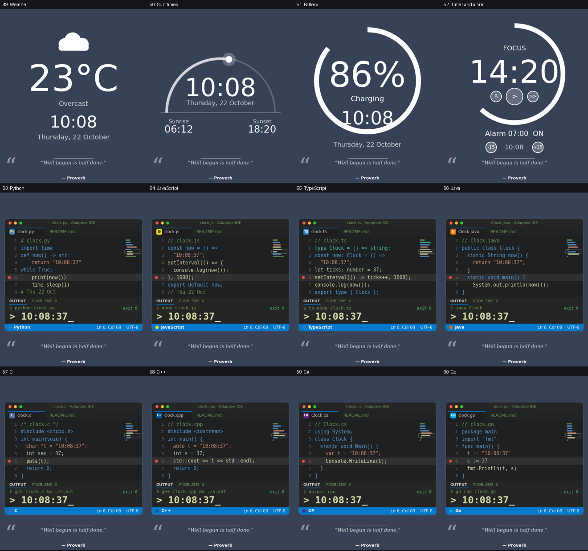

# Adaptive Clock for Rainmeter

A customizable desktop clock featuring **106 unique styles**, designed for Rainmeter on Windows.

**Created by Amika Alankara**



*Previews are approximate renders generated using `tools/preview.py`. Fonts and spacing may differ slightly from the actual Rainmeter skins.*

---

## Getting Started

New to Rainmeter? No problem!

- 📖 **[Complete Installation & User Guide](HELP.md)** - Everything from installing Rainmeter to configuring all 106 clock styles.
- 📥 **[Download Adaptive Clock](../../releases)** - Get the latest `.rmskin` installer from Releases.
- 🐛 **[Report an Issue](../../issues)** - Report bugs or unexpected behaviour.
- 💡 **[Request a Feature](../../issues)** - Suggest improvements and new clock styles.

> **First time using Rainmeter?** Start with the [Complete Help Guide](HELP.md). It walks you through the entire installation process step by step.

---

## Features

### 💻 Coder Clocks

**19 programming-language IDE scenes**, one for each language:

Python, JavaScript, TypeScript, Java, C, C++, C#, Go, Rust, PHP, Ruby, Swift, Kotlin, SQL, HTML, Bash, PowerShell, Lua and Dart.

Each scene features:

- Editor tabs and language badges.
- Syntax-highlighted code with the current time integrated into the code.
- A debugger line that advances through the code every second.
- Breakpoints and live `Ln` / `Col` status information.
- An editor minimap.
- A console that simulates running the program and displays the current time.

Additional developer-inspired clocks include Terminal, Live Preview, Hex Clock, Binary Dots, System Monitor, Epoch and ISO, Git Log, Dot Matrix, Matrix Rain, CI Pipeline, Stack Trace, Hexdump, Neofetch, htop and Test Runner.

**Four editor colour themes:** Dark, Dracula, Monokai and Light.

### 🕒 Everyday Clocks

- Greeting Clock
- Month Calendar
- Year Progress
- Sticky Note
- Week Strip

### 🎨 Visual Themes

Three main visual themes, each with its own accent colours and clock styles.

| Theme | Description |
|---|---|
| Classic | Clean, neutral and timeless |
| Bloom | Pink and lilac aesthetics |
| Volt | Electric blue and cyan aesthetics |

**Bloom styles:** Blossom, Heartbeat, Flutter, Ribbon, Spectrum, Lunar Glow and more.

**Volt styles:** Radar Sweep, Launch, Kickoff, Neon Drive, Level Up, Grid Start, Crest and more.

### 🌌 Clocks for Everyone

Explore a wide variety of visual styles, including:

- Chronograph
- Flip Clock
- Nixie
- Vinyl
- Compass
- Moon Phase
- Skyline
- Aurora
- And many more.

### 🌍 Multilingual Support

Available languages:

- Windows system language
- English
- Spanish
- French
- German
- Portuguese
- Italian
- Sinhala
- Tamil
- Hindi
- Japanese

### ✨ Friendly & Personal Clocks

- Big Quote
- Weekend Countdown
- Year Grid
- Sun and Moon
- Birthday Countdown
- Sparkle Pop
- Pulse Line

### ⚙️ Additional Features

- Optional weather information.
- Sunrise and sunset times.
- Daylight duration and sun position.
- Battery information.
- Focus timer with alarm.
- Customisable quotes.
- Adaptive text colours based on wallpaper brightness.
- Windows accent-colour support.
- 12/24-hour time formats.
- Automatic style rotation and shuffle.
- Five-page settings interface.
- Interactive style gallery.

### 🔐 Privacy First

Your location stays on your computer.

Sunrise and sunset calculations are performed locally using your Windows location or a time-zone-based fallback. Your location is not sent to an external service for these calculations.

Weather is optional and disabled by default. If enabled, the clock requests weather information from Open-Meteo every 15 minutes using coordinates rounded to one decimal place.

See [Privacy and Location](HELP.md#privacy-and-location) for details.

---

## Requirements

- Windows 10 or Windows 11.
- [Rainmeter 4.x](https://www.rainmeter.net/).
- PowerShell (included with Windows).

---

## Installation

### Method 1: Install using the `.rmskin` package (Recommended)

1. Download the latest `AdaptiveClock-<version>.rmskin` package from [GitHub Releases](../../releases).
2. Double-click the downloaded `.rmskin` file.
3. The Rainmeter Skin Installer will open.
4. Follow the installation prompts.
5. Once installation is complete, open Rainmeter.
6. Locate `AdaptiveClock` in the skin list.
7. Expand the folder and load `AdaptiveClock.ini`.

### Method 2: Install from Source

1. Download or clone this repository.
2. Locate the `AdaptiveClock` folder.
3. Copy the entire folder into:

   `Documents\Rainmeter\Skins\`

4. Open Rainmeter.
5. Select **Refresh all** from the Rainmeter tray menu.
6. Navigate to `AdaptiveClock`.
7. Load `AdaptiveClock.ini`.

Additional interfaces:

- `AdaptiveClock\Settings\Settings.ini`
- `AdaptiveClock\Gallery\Gallery.ini`

You can also open Settings and Gallery using the last two entries in the clock's right-click menu.

**Important:** Keep the complete `AdaptiveClock` folder together. Do not separate the INI files, Lua script, language files or PowerShell scripts.

If you edit `AdaptiveClock.lua`, save it as plain ASCII without a BOM.

For detailed installation instructions, see the **[Complete Help Guide](HELP.md)**.

---

## Using the Clock

### Mouse Controls

| Action | Behaviour |
|---|---|
| Double-click | Switch to the next clock style |
| Hover | Display the style name, number and lock status |
| Right-click | Open the clock's context menu |

### Right-Click Menu

The context menu provides access to:

- Next style.
- Random style.
- Lock or unlock the current style.
- Resume shuffle.
- Re-check wallpaper brightness.
- Change profile.
- Change visual theme.
- Change language.
- Change colour mode.
- Next quote.
- Show or hide quotes.
- Switch between 12-hour and 24-hour formats.
- Skip the current style.
- Restore all skipped styles.
- Open Settings.
- Open the Style Gallery.

### Settings Window

The Settings interface contains five pages.

| Page | Available Settings |
|---|---|
| Style | Profile, theme, code colours, text colour and shuffle duration |
| Language | Language, time format and week start |
| Quote | Quote visibility, style, size and rotation |
| Extras | Smooth seconds, weather and focus timer |
| Actions | Next, random, lock, skip and gallery actions |

The settings window displays the current page and active clock style. Each setting highlights its currently selected value.

---

## Configuration

All primary settings are available in the `[Variables]` section of `AdaptiveClock.ini`.

| Variable | Values | Description |
|---|---|---|
| `Profile` | `All`, `Coder`, `Everyday` | Select available styles and quotes |
| `Theme` | `Neutral`, `Bloom`, `Volt` | Select the accent palette |
| `CodeTheme` | `Dark`, `Dracula`, `Monokai`, `Light` | Editor and terminal colours |
| `Language` | 11 supported options | Date names, greetings and labels |
| `ColorMode` | `Invert`, `Accent`, `White`, `Black` | Text colour behaviour |
| `ShuffleMinutes` | `1`–`1440` | Automatic style rotation interval |
| `SkipStyles` | e.g. `3,7,12` | Exclude selected styles |
| `LockedStyle` | `0` or style number | Lock a particular style |
| `HourFormat` | `%H`, `%#I` | 24-hour or 12-hour format |
| `QuoteHidden` | See Settings | Show or hide quotes |
| `QuoteMinutes` | See Settings | Quote rotation interval |
| `QuoteStyle` | See Settings | Quote presentation |
| `QuoteSize` | See Settings | Quote text size |
| `Smooth` | `0`, `1` | Enable smooth seconds |
| `Latitude` | Coordinate | Optional sunrise/sunset override |
| `Longitude` | Coordinate | Optional sunrise/sunset override |
| `WeatherLatitude` | Coordinate | Optional weather location |
| `WeatherLongitude` | Coordinate | Optional weather location |
| `Birthday` | `MM-DD` | Birthday countdown date |
| `WeatherOff` | `0`, `1` | Enable or disable weather |
| `TempUnit` | `celsius`, `fahrenheit` | Weather temperature unit |
| `PomoWork` | Minutes | Focus timer work duration |
| `PomoBreak` | Minutes | Focus timer break duration |
| `TimerBeep` | `0`, `1` | Enable or disable timer sound |
| `AlarmTime` | `HH:MM` | Alarm time |
| `AlarmOn` | `0`, `1` | Enable or disable alarm |
| `WeekStart` | `0`, `1` | Sunday or Monday first |
| `FontText` | Font name | Main text font |
| `FontLight` | Font name | Light text font |
| `FontBold` | Font name | Bold text font |
| `FontMono` | Font name | Monospaced font |
| `Cities` | `NAME:offset:RULE\|...` | World-time cities (maximum 5) |

**Legacy compatibility:** The old `Girl` and `Boy` theme values are still supported.

Quotes remain in English. Weather descriptions are also in English.

---

## Customisation

### World-Time Cities

Edit the `Cities=` variable in `AdaptiveClock.ini`.

Format:

`NAME:offset:RULE|NAME:offset:RULE`

Supported daylight-saving rules:

- `US`
- `EU`
- `AU`
- `-` (no daylight-saving adjustment)

Maximum: 5 cities.

### Custom Quotes

1. Rename `quotes.example.txt` to `quotes.txt`.
2. Open the file using a text editor.
3. Add one quote per line using:

   `Quote text | Author`

4. Save the file.

Your custom quotes replace the built-in quotes across all profiles.

### Custom Styles

The generated `AdaptiveClock.ini` is produced by `tools/gen_ini.py`.

To add or modify styles:

1. Edit the relevant style functions in `tools/gen_ini.py`.
2. Run the generator.
3. Update `StyleCount` if styles have been added or removed.

---

## Development

The following files are generated:

- `AdaptiveClock.ini`
- `Settings.ini`
- `Gallery.ini`

Edit the corresponding generator scripts instead of manually changing generated files.

From the `tools` directory, run:

```bash
python gen_ini.py
python gen_skins.py
python check_ini.py
```

Or run all three together:

```bash
python gen_ini.py && python gen_skins.py && python check_ini.py
```

### Preview Generation

Generate visual previews of all clock styles:

```bash
python preview.py
```

Requirements:

- Matplotlib
- Pillow

Previews are saved to `docs/`. The script also warns about text overlapping or exceeding the clock area.

### Build the Rainmeter Package

Generate the distributable `.rmskin` package:

```bash
python build_rmskin.py
```

The package is saved in:

`dist/AdaptiveClock-<version>.rmskin`

### Adding a Language

1. Open `tools/languages.lua`.
2. Copy an existing language block.
3. Translate the relevant strings.
4. Add the language to `LANGUAGES` in `AdaptiveClock.lua`.
5. Add it to `LANGS` in `tools/gen_skins.py`.
6. Run the generators.

### Automated Checks

GitHub Actions checks generated files on every push and attaches the `.rmskin` package to a release when a version tag such as `v4.1` is pushed.

---

## Troubleshooting

| Problem | Suggested Solution |
|---|---|
| Clock does not appear | Refresh Rainmeter and load `AdaptiveClock.ini` again |
| Clock appears blank | Check Rainmeter's About → Log for red `ERR` messages |
| Language does not change | Check that the relevant `.inc` file exists in `AdaptiveClock/Languages/` |
| Location not found | Enable Windows location services or configure coordinates manually |
| Sunrise/sunset unavailable | Check location permissions and refresh the location |
| Custom quotes do not appear | Check the filename and `text \| author` format |
| Weather does not appear | Enable weather and check the internet connection |
| Clock does not update | Refresh the skin or restart Rainmeter |

For detailed solutions, visit the **[Troubleshooting Guide](HELP.md#troubleshooting)**.

---

## Privacy and Location

Adaptive Clock is designed to keep location processing local.

- Location detection happens on your computer through `LocationFinder.ps1`.
- Windows location services are used when available.
- If Windows cannot provide a location, the script estimates coordinates from your time zone using an internal lookup table.
- Coordinates are rounded to approximately 1 km and saved locally in `AdaptiveClock\State\location.txt`.
- The state directory is listed in `.gitignore`.
- Sunrise, sunset, daylight duration and sun position are calculated locally.
- Weather is the only feature that uses an external network connection. It is disabled by default.
- When weather is enabled, coordinates rounded to one decimal place are sent to `api.open-meteo.com` every 15 minutes.
- You can configure a separate weather location using `WeatherLatitude` and `WeatherLongitude`.
- Wallpaper brightness is checked locally. Your wallpaper is not uploaded.

See [HELP.md - Privacy and Location](HELP.md#privacy-and-location) for the complete explanation.

---

## Author

**Amika Alankara**

Created with an interest in desktop customisation, programming and creative interface design.

---

## Credits

Style ideas are inspired by popular Rainmeter clock skins.

Quotes are attributed to commonly cited sources. Please independently verify attributions before commercial redistribution.

---

## License

This project is licensed under the **MIT License**. See [LICENSE](LICENSE) for details.

---

<p align="center">
  <b>106 styles. One desktop. Your way.</b>
  <br>
  <a href="HELP.md">Read the Complete Help Guide</a>
  ·
  <a href="../../releases">Download</a>
  ·
  <a href="../../issues">Get Support</a>
</p>